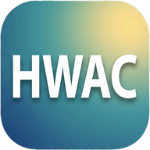

# HWA Converter

**The Android media converter that encodes on your phone's hardware first.**

Every other converter app encodes on the CPU, even though your phone has a
dedicated media engine built for exactly this. HWA Converter asks the device
what its media engine can actually do, and builds its presets from the answer.

---

## ⬇️ Download

Tap a button to download the APK from the **latest release**:

| OS | Download |
|---|---|
| Android |     |

Which one?

- **ARMv8** is the right pick for almost every phone, including all
  recent MediaTek, Qualcomm, Exynos and Tensor devices
- **Universal** works everywhere if you're not sure. It's just bigger
- **ARMv7** is the legacy edition for old 32-bit phones. Same app, but
  built on the older FFmpeg 6.0 engine, the last one that ever shipped
  a 32-bit build, so it has no VP9 or AV1 hardware presets
- **x64** is for emulators and x86 Chromebooks

Older releases live on the **[Releases page](https://github.com/justVisiting992/HWA-Converter/releases)**.
Requires **Android 7.0 (API 24)** or newer.

---

## 🤔 Why hardware-first?

Your phone's chip has a media engine: fixed-function silicon that encodes and
decodes video far faster and cooler than the CPU. On a Dimensity 9400+, a
25-minute 1080p AV1 → HEVC conversion ran at **8.3× realtime** with *both*
decode and encode on the media engine. The CPU mostly watched.

Converter apps almost never use it. They ship FFmpeg presets that default to
software encoding, so your phone heats up, the battery drains, and the media
engine sits idle.

HWA Converter flips the default:

1. **Probe.** At startup it enumerates the device's MediaCodec encoders and
   decoders: component names, hardware vs software, max resolution, bitrate
   range, profiles. MediaTek, Qualcomm, Samsung Exynos, HiSilicon Kirin and
   Google Tensor are all probed the same way.
2. **Offer only what's real.** A hardware preset appears only if your chip
   actually has that encoder. No AV1 hardware preset on a chip with no AV1
   encoder. Nothing is faked.
3. **Convert on the engine.** Hardware decode into hardware encode wherever
   the device allows it, with bitrates sized to the input and capped by what
   the encoder component itself reports.
4. **Never fall back silently.** If a path you picked isn't available, the
   job says so in plain language. If a hardware-decoded job fails in its
   first seconds, it retries once on CPU decode, and tells you it did.

There are no vendor settings anywhere. The app detects the hardware and
adapts on its own.

---

## 🎛️ Presets

Seventeen presets in five families, plus a full manual mode:

| Family | Presets |
|---|---|
| ⚡ **Hardware encode** | H.264 · H.265/HEVC · VP9 (WebM) · AV1 (WebM), each shown only when your media engine has it |
| 🎓 **Software encode** | H.264 max quality (libx264, CRF 18) · H.265/HEVC max quality (libx265, CRF 22) · VP9 (WebM) · AV1 |
| 🎵 **Audio only** | AAC · MP3 · Opus · FLAC · WAV |
| 📦 **No re-encode** | Remux to MP4 · Remux to MKV · Trim. Stream copy, seconds fast, quality untouched |
| 🎨 **Create** | Animated GIF |

**Custom mode** puts it all in your hands: container (MP4/MKV/WebM), video
codec (copy, hardware, software, or none), audio codec, bitrate or CRF,
downscale to 1080p/720p/480p/360p, and a hardware-decode toggle.
Combinations that can't work are refused up front, with the reason written
out, never a silent skip.

Hardware encoding is for speed, sharing and everyday converts. Software
max-quality mode is for archiving, where every detail matters. Both are
first-class citizens here.

---

## ✨ Features

- 🔍 **Your hardware screen.** The full probe report: every video encoder
  and decoder on your device, what it can do, and which engine vendor made it
- 🧵 **Background conversions.** A foreground service keeps jobs alive with
  a live notification: progress, speed, ETA, output size, and a Cancel button
- 📋 **A real queue, on your say-so.** Picked files wait until you tap
  **Start**; nothing converts behind your back. Jobs then run one at a time
  (hardware encoders are scarce silicon), each card showing live progress,
  the *exact* ffmpeg command that ran, and the output estimate before you start
- 🗂️ **Tidy output.** Finished files land in `Movies`, `Music` or
  `Pictures` under a **HWA Converter** folder; failed jobs clean up after
  themselves, no half-written files
- 🪵 **Honest debug logs.** Every finished job keeps its full log in memory;
  tap it to save to `Download/HWA Converter`, or share it straight from the card
- 🎨 **Make it yours.** Material You plus seven fixed color schemes, light /
  dark / follow-the-phone, and **nine launcher icons** to pick from in
  Look & Feel
- 🌍 **36 languages.** The whole app speaks your language, picked in
  Look & Feel: Europe's major languages, Brazilian Portuguese, Japanese,
  Korean, Simplified and Traditional Chinese, and Persian with a full
  right-to-left layout and the Vazirmatn typeface. Your phone's language
  is the default
- 🔄 **Updates from GitHub.** The app checks this repo's releases once a
  day and offers a new version in a floating card: Download & Install, or
  Download Later. On by default, switchable in About
- 🧭 **A guided first run.** A short tour points at where things live;
  replay it any time from About
- 🖼️ **Thumbnails and facts.** Queue cards show a frame from your video,
  its duration, resolution, codec and size at a glance

---

## 🔒 Privacy

The app's one network use is updates: it checks this repo's GitHub
releases and, when you tap Download & Install, downloads the new APK.
That is what the `INTERNET` permission is for, and nothing else. The
automatic check is on by default, can be switched off in About, and
disables itself when the app has no network access. No uploads, no
analytics, no ads, no accounts. Your files are converted on your phone
and stay on your phone.

---

## 🛠️ Building from source

- Kotlin + Jetpack Compose (Material 3), minSdk 24, targetSdk 35
- Engine: [FFmpegKit](https://github.com/ffmpegkit-maintained/ffmpeg) full-GPL
  8.1.9 (FFmpeg 8.1.2: libx264, libx265, libvpx, libaom, LAME, Opus), fetched
  from Maven Central by CI against a pinned SHA-256
- `./gradlew assembleDebug` with JDK 17, or just read the GitHub Actions
  workflow, which builds every push and attaches split APKs to tagged releases

---

## 📜 License & credits

GPL-3.0. See [LICENSE](https://github.com/justVisiting992/HWA-Converter/blob/main/LICENSE).
The GPL is inherited from the full-GPL FFmpeg build, and it's embraced, not
tolerated: an app built on free software stays free.

Launcher icon artwork by the maintainer. FFmpeg is a trademark of Fabrice
Bellard; this project is not affiliated with the FFmpeg project.
